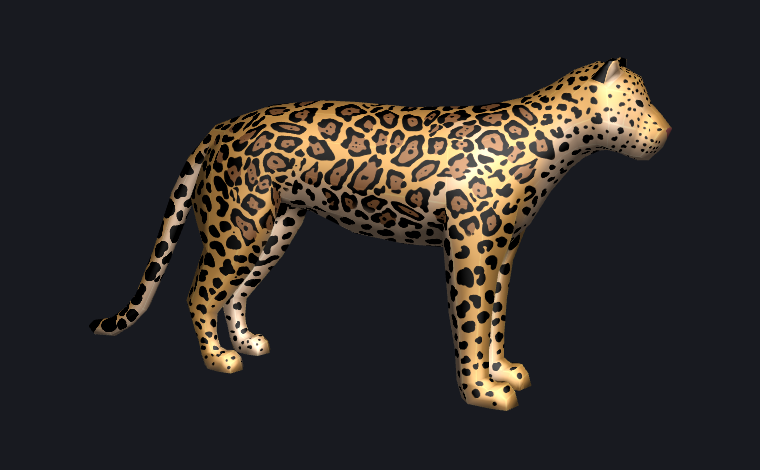
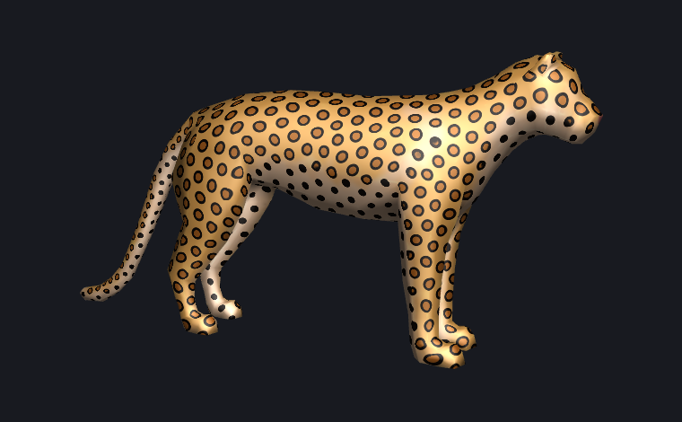
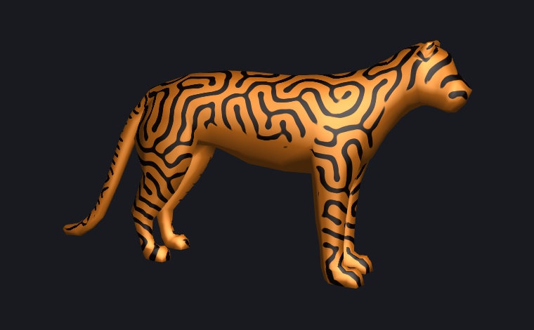
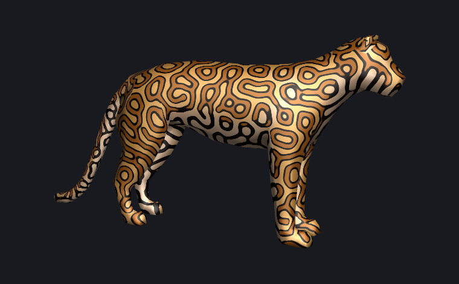
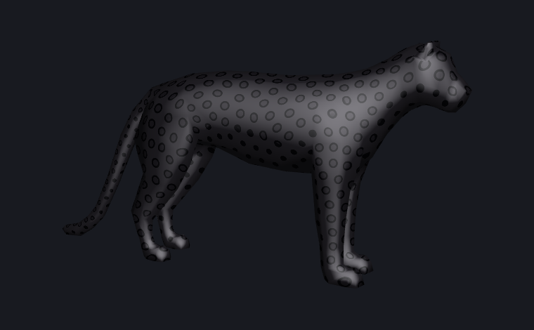
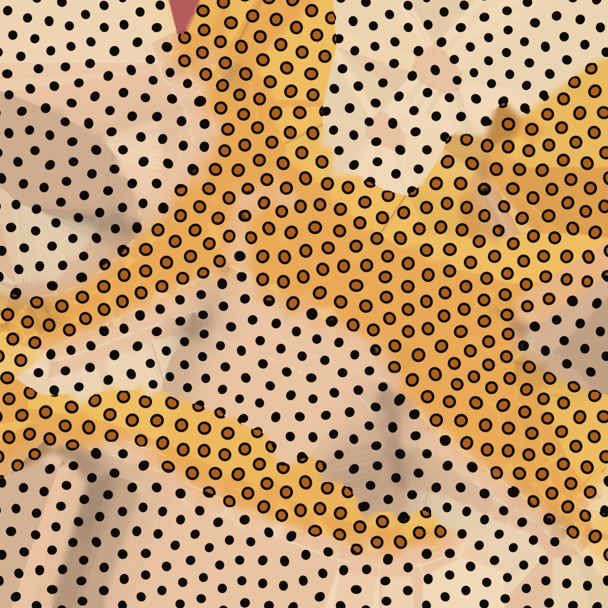

# Textura procedural: Jaguar con reacción-difusión — Visual Computing 2026-II

Modelo de reacción-difusión de Turing (Gray-Scott) en p5.js, usado como textura en vivo sobre un jaguar 3D con iluminación Phong. El patrón crece directamente sobre la piel del modelo y se puede personalizar con botones y sliders.

| |
|---|
|  |

<!-- TODO: reemplazar por la URL real cuando GitHub Pages esté activo -->
**Ver en línea:** _pendiente_

## Integrantes

| Integrante | GitHub |
|---|---|
| Oscar Leonardo Riveros Perez | [ShryhakAkizuki](https://github.com/ShryhakAkizuki) |
| Camilo Londoño Moreno | [CamiloLM](https://github.com/CamiloLM) |
| Omar Nicolas Guerrero Guerrero | [camisabo](https://github.com/camisabo) |
| Oscar Ivan Ulises Gutierrez Palacios | [10scar](https://github.com/10scar) |

## Objetivo

Implementar el modelo de reacción-difusión de Turing en p5.js, tomando como referencia [el tutorial de Karl Sims](https://www.karlsims.com/rd.html).

| Tarea | Dónde se cumple |
|---|---|
| Elegir un animal favorito | El jaguar |
| Descargar un modelo OBJ con mapeo UV | [`assets/models/Jaguar.obj`](assets/models/Jaguar.obj), de Poly Pizza (ver [Créditos](#créditos-y-referencias)) |
| Crear una textura con reacción-difusión | [`reactionDiffusion.js`](reactionDiffusion.js) y [`palettes.js`](palettes.js) |
| Aplicar la textura al modelo 3D | [`jaguar.js`](jaguar.js) y [`sketch.js`](sketch.js) |
| Agregar iluminación Phong | [`shaders/phong.vert`](shaders/phong.vert) y [`shaders/phong.frag`](shaders/phong.frag) |
| Agregar botones para personalizar la textura | [`gui.js`](gui.js) |

## Correr en local

No hay nada que instalar ni compilar. Basta con servir la carpeta del proyecto:

```bash
python -m http.server 8000
```

y abrir http://localhost:8000.

Hace falta un servidor HTTP porque `loadModel`, `loadImage` y `loadShader` no funcionan abriendo `index.html` directamente (`file://`). `npx serve .` también sirve.

## Controles

Los controles están en un panel de [lil-gui](https://lil-gui.georgealways.com/) a la derecha, agrupados en carpetas (`Pattern`, `Palette`, `Simulation`, `Mapping`, `Phong`, `View`, `Export`). Encima del panel está la vista previa de la textura. Las carpetas `Pattern` y `Phong` muestran la ecuación que controlan sus sliders, con los símbolos ajustables resaltados; el nombre de cada slider termina con su símbolo.

| Control | Acción |
|---|---|
| Arrastrar sobre el jaguar | Rotar la cámara |
| Rueda del ratón | Acercar / alejar |
| Arrastrar sobre la vista previa de la textura | Pintar químico B: siembra manchas en ese punto del cuerpo |
| `Jaguar` · `Leopard` · `Stripes` · `Coral` | Patrón: cambia *f* y *k* y reinicia la simulación |
| `Jaguar` · `Panther` · `Snow Leopard` · `Tiger` · `Original` | Paleta de colores. Cada una activa o desactiva `Use original body coloring` según le convenga. `Original` muestra la textura original del modelo, para comparar |
| `Use original body coloring` | Pone las manchas sobre los colores originales del modelo (vientre crema, lomo dorado, nariz rosada) |
| `Spot mask` | Encoge las manchas en las zonas claras (vientre, patas y cara) hasta dejarlas como puntos negros, y las quita de la nariz |
| `Feed rate (f)` · `Kill rate (k)` | Parámetros del modelo Gray-Scott: qué tan rápido se repone A y qué tan rápido se elimina B |
| `Diffusion A (dA)` · `Diffusion B (dB)` | Qué tan rápido se difunde cada químico |
| `Steps/frame` | Iteraciones de la simulación por cuadro |
| `Brush size` | Radio del pincel de la vista previa, en celdas: las manchas se siembran al azar dentro de él |
| `Seed mode` (`Random spots`, `Center blob`, `Noise`) + `Reseed` | Reinicia la simulación con una nueva semilla del tipo elegido |
| `Pause` / `Play` | Congela o reanuda la simulación |
| `Spot scale` | Cuántas veces se repite el patrón sobre el modelo: más alto, manchas más pequeñas; por debajo de 1, más grandes |
| `Smooth normals` | Normales suavizadas o facetadas |
| `Ambient (Ka)` · `Diffuse (Kd)` · `Specular (Ks)` | Coeficientes de Phong: luz ambiental, difusa y especular |
| `Shininess (n)` | Exponente del brillo: más alto, brillo más pequeño y concentrado |
| `Light color (Lc)` | Color de la luz |
| `Light orbit` | La luz gira alrededor del jaguar |
| `Auto-rotate` | El jaguar gira solo |
| `Reset view` | Devuelve la cámara a su posición inicial |
| `Screenshot` · `Save texture` · `Record GIF` | Exportar el lienzo (PNG), la textura (PNG de 1024×1024) o un GIF de 5 s (480 px de ancho, 20 fps) |

## Teoría

### Turing y la morfogénesis

En *The Chemical Basis of Morphogenesis* (1952), Alan Turing propuso que dos sustancias que reaccionan entre sí y se difunden a velocidades distintas pueden producir patrones estables a partir de un estado casi uniforme. Manchas, rayas y laberintos aparecen solos, sin que nada los dibuje. Es una de las explicaciones de los patrones en la piel de animales como el jaguar, el leopardo o el pez globo.

### Modelo Gray-Scott

Dos químicos, **A** y **B**, viven en una grilla. A se agrega a una tasa de alimentación *f*, B se elimina a una tasa *k*, y dos B convierten un A en B (A + 2B → 3B):

$$\frac{\partial A}{\partial t} = D_A \nabla^2 A - AB^2 + f(1 - A)$$

$$\frac{\partial B}{\partial t} = D_B \nabla^2 B + AB^2 - (k + f)B$$

| Parámetro | Qué controla | Valor por defecto |
|---|---|---|
| *f* (feed) | Qué tan rápido se repone A | Depende del patrón |
| *k* (kill) | Qué tan rápido se elimina B | Depende del patrón |
| *D<sub>A</sub>* | Difusión de A | 1.0 |
| *D<sub>B</sub>* | Difusión de B (más lenta que A, que es la clave de Turing) | 0.5 |
| Δ*t* | Paso de tiempo | 1.0 |

Cada paso actualiza la grilla con la forma discreta:

$$A' = A + \left(D_A \nabla^2 A - AB^2 + f(1 - A)\right)\Delta t$$

$$B' = B + \left(D_B \nabla^2 B + AB^2 - (k + f)B\right)\Delta t$$

### Laplaciano

$\nabla^2$ se aproxima con una convolución 3×3. El centro pesa −1, los vecinos adyacentes 0.2 y los diagonales 0.05:

| | | |
|:---:|:---:|:---:|
| 0.05 | 0.2 | 0.05 |
| 0.2 | −1 | 0.2 |
| 0.05 | 0.2 | 0.05 |

### Patrones

Cambiando solo *f* y *k* aparecen patrones muy distintos:

| Patrón | *f* | *k* |
|---|---|---|
| `Jaguar` (rosetas) | 0.0367 | 0.0649 |
| `Leopard` (manchas pequeñas) | 0.030 | 0.062 |
| `Stripes` (rayas / laberinto) | 0.029 | 0.057 |
| `Coral` | 0.0545 | 0.062 |

## Implementación

### Simulación

- Dos grillas de 256×256 (`Float32Array`) para A y B, con doble buffer: se lee de una y se escribe en la otra, y se intercambian en cada paso.
- Los bordes **dan la vuelta** (topología de toro), así que la textura es periódica y se puede repetir sin costuras.
- Se corren varios pasos por cuadro (`Steps/frame`, 10 por defecto) y el patrón evoluciona en vivo sobre el modelo.
- A y B se mantienen entre 0 y 1. Con Δ*t* = 1, una semilla dura (B = 1) se pasaría de esos límites y la simulación divergiría.
- Semilla: A = 1 en toda la grilla y B = 1 en pequeños cuadrados al azar (`Random spots`), en un grupo en el centro (`Center blob`) o en bloques de ruido (`Noise`).
- El lazo interno no reserva memoria y lee solo tres celdas nuevas por químico en cada paso: al avanzar por una fila reutiliza las sumas de las dos columnas anteriores.

### Pincel

En los patrones de manchas (`Jaguar`, `Leopard`) solo sobreviven manchas aisladas: una zona grande de B, o varias manchas muy juntas, agotan el químico A y se apagan. Por eso el pincel no pinta un trazo sólido. Siembra manchas ya formadas (B alto y A bajo en el centro, con borde suave) en puntos al azar dentro de su radio, y deja al menos 16 celdas entre una y otra. Cada mancha sembrada crece y se divide como las demás.

### Color: rosetas de jaguar

Con $t = \mathrm{clamp}(A - B)$, cada paleta asigna a *t* un color de mancha con opacidad (tabla precalculada de 256 entradas):

- *t* alto (fondo): transparente, se ve el color del cuerpo.
- *t* medio (borde de la mancha): negro.
- *t* bajo (centro, donde B es máximo): naranja oscuro.

El resultado es un anillo negro con centro naranja: la roseta del jaguar. Ese color se compone sobre el color del cuerpo, que es un color sólido de la paleta o, con `Use original body coloring`, la coloración original del modelo.

**Coloración original sin manchas.** La textura original ya trae sus manchas pintadas, así que al cargar se le quitan: los píxeles negros y los marrones de las rosetas se rellenan desde sus bordes con el color de los vecinos y luego se suavizan. Queda solo la coloración del cuerpo (lomo dorado, vientre crema, nariz rosada), y sobre ella van las manchas de la simulación.

**Máscara de manchas.** De esa coloración sale también `Spot mask`: en las zonas poco saturadas (vientre, patas, cara) se le suma un valor a *t* antes de consultar la tabla. Eso encoge las manchas hasta dejar solo su núcleo, que cae en la franja negra de la paleta. El resultado son puntos negros sólidos, como en un jaguar real, que tiene rosetas en el lomo y puntos en el vientre y las patas.

**La tabla se consulta dos veces.** En la CPU ([`palettes.js`](palettes.js)) para la vista previa y para `Save texture`, y por píxel en el fragment shader para el modelo. En el shader la GPU interpola *t* entre téxeles **antes** de consultar la paleta, así que el borde de cada mancha queda nítido aunque la textura de 256×256 se vea muy ampliada. El shader recibe por separado el campo *t*, la paleta, la coloración del cuerpo y la máscara.

### Mapeo UV

El modelo tiene las UV **en espejo**: las mitades izquierda y derecha del cuerpo comparten el mismo despliegue, que es media piel extendida (la cabeza arriba a la izquierda, el lomo en diagonal, las patas hacia los lados), con la cola y algunas piezas pequeñas en islas aparte. Por eso el patrón, que crece en espacio UV, fluye continuo de la cabeza a las patas y sale simétrico a ambos lados, como en un animal real.

`Spot scale` multiplica las UV con las que se lee el campo de la simulación. Como el campo es periódico, repetirlo no crea costuras. La coloración del cuerpo y la máscara se leen con las UV sin escalar, porque pertenecen al cuerpo y no al patrón.

### Normales suavizadas

El modelo es low-poly con normales planas, lo que hace ver las caras con Phong. `Smooth normals` promedia las normales de los vértices que comparten posición **sin fusionarlos**, para no dañar las UV ni las costuras de la textura.

## Iluminación Phong

El color se calcula **por píxel** en el fragment shader, con N, L, V y R normalizados en espacio de cámara:

$$I = K_a \, C + K_d \, \max(N \cdot L, 0) \, C \, L_c + K_s \, \max(R \cdot V, 0)^{n} \, L_c$$

| Término | Qué aporta |
|---|---|
| Ambiental ($K_a$) | Luz base, para que las sombras no queden negras |
| Difusa ($K_d$) | Depende del ángulo entre la normal y la luz; da el volumen |
| Especular ($K_s$, $n$ = `Shininess (n)`) | El brillo que se mueve con la luz; $n$ alto da un brillo más pequeño y concentrado |

$C$ es el color de la textura de reacción-difusión (`skinColor`, la consulta de la paleta descrita arriba) y $L_c$ el color de la luz. La posición de la luz está en espacio de mundo y el shader la pasa a espacio de cámara con `uViewMatrix`, así que la luz se queda quieta cuando se rota la cámara.

```glsl
vec3 N = normalize(vNormal);
vec3 L = normalize(lightPosEye - vPosition);
vec3 V = normalize(-vPosition);
vec3 R = reflect(-L, N);

vec3 tex      = skinColor(vTexCoord);
vec3 ambient  = uKa * tex;
vec3 diffuse  = uKd * max(dot(N, L), 0.0) * tex * uLightColor;
vec3 specular = uKs * pow(max(dot(R, V), 0.0), uShininess) * uLightColor;

fragColor = vec4(ambient + diffuse + specular, 1.0);
```

## Galería

| Antes (`Original`) | Después (`Jaguar`) |
|---|---|
|  |  |

| `Leopard` | `Stripes` + `Tiger` | `Coral` |
|---|---|---|
|  |  |  |

| `Panther` | `Snow Leopard` | Textura sola |
|---|---|---|
|  |  |  |

## Tecnologías

JavaScript sin build:

- [p5.js](https://p5js.org/) 2.3.1 (copia local): modo `WEBGL`, carga del modelo y cámara.
- [lil-gui](https://lil-gui.georgealways.com/) 0.21.0 (copia local): panel de controles.
- GLSL: shader de Phong propio.
- Simulación de reacción-difusión en CPU, implementada desde cero.

## Estructura

```
├── index.html            Página: lienzo, panel de controles y créditos
├── style.css             Diseño de dos columnas
├── sketch.js             setup/draw, cámara, luz y uniforms del shader
├── reactionDiffusion.js  Simulación Gray-Scott y textura
├── palettes.js           Paletas y composición sobre el color del cuerpo
├── jaguar.js             Carga del OBJ, orientación y normales suavizadas
├── gui.js                Panel lil-gui y vista previa de la textura
├── shaders/              phong.vert y phong.frag
├── assets/
│   ├── libs/             p5.js y lil-gui
│   └── models/           Jaguar.obj, Jaguar.mtl y Jaguar_BaseColor.png
└── docs/screenshots/     Imágenes del README
```

## Créditos y referencias

- Modelo: Jaguar by Poly by Google [CC-BY 3.0] (https://creativecommons.org/licenses/by/3.0/) via Poly Pizza (https://poly.pizza/m/4fb-oMr2uUF)
- Karl Sims, [*Reaction-Diffusion Tutorial*](https://www.karlsims.com/rd.html).
- A. M. Turing, *The Chemical Basis of Morphogenesis*, Philosophical Transactions of the Royal Society of London B, 237 (641), 37–72, 1952.
- [p5.js](https://p5js.org/).
- [lil-gui](https://lil-gui.georgealways.com/), de George Michael Brower (licencia MIT).

## Licencia

El código de este proyecto está bajo la licencia [MIT](LICENSE). El contenido de terceros conserva su propia licencia:

| Contenido | Autor | Licencia |
|---|---|---|
| Modelo del jaguar ([`assets/models/`](assets/models/)) | Poly by Google, vía [Poly Pizza](https://poly.pizza/m/4fb-oMr2uUF) | [CC-BY 3.0](https://creativecommons.org/licenses/by/3.0/) |
| [p5.js](https://p5js.org/) ([`assets/libs/p5.js`](assets/libs/p5.js)) | Processing Foundation | [LGPL-2.1](https://github.com/processing/p5.js/blob/main/license.txt) |
| [lil-gui](https://lil-gui.georgealways.com/) ([`assets/libs/lil-gui.umd.min.js`](assets/libs/lil-gui.umd.min.js)) | George Michael Brower | [MIT](https://github.com/georgealways/lil-gui/blob/master/LICENSE) |

Proyecto académico sin fines comerciales.
